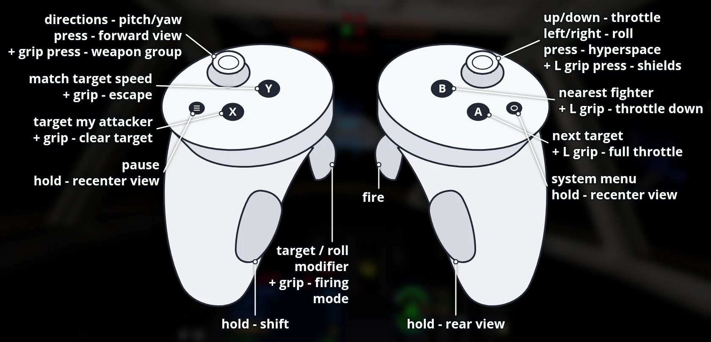

# OpenXW VR for Meta Quest

**Download, install guide, controls and pictures: [portroyale.online/openxw.html](https://portroyale.online/openxw.html)**

Standalone Meta Quest 3 port of OpenXW (Star Wars: X-Wing) with OpenXR:
menus on a virtual screen, head-tracked stereo 3D space in
flight (1998 flight engine), 3D cockpits for the X-Wing, Y-Wing, A-Wing and
B-Wing with the original instruments, and Touch controller support with
radial menus on both grips.

You need your own copy of X-Wing (Steam "STAR WARS X-Wing Special
Edition"). The APK contains no game data.

## Install

1. Install the APK with SideQuest or `adb install OpenXW-VR-*.apk`.
2. Copy the game data to the Quest's internal storage (Steam folder
   `STAR WARS X-Wing`):
   - `collectors_cd` (1994 CD version) to `/sdcard/OpenXW/XW94`
   - `remastered` (1998 Windows version) to `/sdcard/OpenXW/XW98`

       adb push ".../STAR WARS X-Wing/collectors_cd/." /sdcard/OpenXW/XW94/
       adb push ".../STAR WARS X-Wing/remastered/." /sdcard/OpenXW/XW98/

3. Start "OpenXW VR" from Unknown Sources. On first start, allow "access
   to all files" when Android asks (or run
   `adb shell appops set --uid com.bilko.openxwvr MANAGE_EXTERNAL_STORAGE allow`).

## Controls

Recenter: hold the Meta button on the right controller, or hold the left
Menu button for one second.

Menus:

| Input | Action |
|---|---|
| Laser + trigger | Click |
| Right grip | Right-click |
| Left stick | Arrow keys |
| A | Enter |
| B | Escape |
| Y | Space |
| Laser + trigger on a text field | Open the on-screen keyboard (pilot name) |
| Left Menu, short press | Escape |

Flight (the Touch controllers act as one gamepad; every button can be
remapped in Settings > Controller):

| Input | Action |
|---|---|
| Left stick | Pitch and yaw (up = nose down, like a flight stick) |
| Right stick left/right | Roll |
| Right stick up/down | Throttle lever |
| Right trigger | Fire |
| Left trigger (hold) | Target / roll modifier |
| A / B / X / Y | Next target / nearest fighter / my attacker / match speed |
| Left stick click | Forward view |
| Right stick click | Hyperspace |
| Left Menu, short press | Pause |
| Left grip (hold) | Radial menu: weapons and power |
| Right grip (hold) | Radial menu: targets and orders |

Radial menus: hold a grip and a star of eight commands appears above that
controller. Tilt the same hand's stick towards a command and release the
grip to run it; release with the stick centred to cancel. The stick doesn't
fly while it is choosing; everything else keeps working.

| Direction | Left (weapons and power) | Right (targets and orders) |
|---|---|---|
| Up | Laser recharge rate | Clear target |
| Up-right | Shield recharge rate | Target in sights |
| Right | Cycle weapon group | Map |
| Down-right | Full throttle | Wingmen: attack my target |
| Down | Throttle down | Wingmen: cover me |
| Down-left | S-foils | Rear view (left stick click: forward again) |
| Left | Cycle firing mode | Flight menu (Escape) |
| Up-left | Cycle shield direction | Previous target |

## Known limitations (beta)

- Quest 3 tested only. The same APK should run on PICO 4 / Neo 3 (PICO OS
  5.9.0 or newer), untested.
- 3D cockpits for the X-Wing, Y-Wing, A-Wing and B-Wing (1998 flight
  engine); their small built-in screens are dark, the original instruments
  stay in front of you.
- Signed with a debug key.

## Credits

OpenXW by elyosh (https://github.com/elyosh/OpenXW). 3D cockpit models by
the XWA Upgrade team (https://xwaupgrade.com/), as shipped with X-Wing
Revival by Raptor007 (https://www.raptor007.com/xwing/); converted by
`tools/quest/gen_xw_vr_cockpits.py`.

## Building

    tools/quest/build-deps.sh      # SDL3, zstd, FFmpeg for Android arm64
    tools/quest/build-native.sh    # libmain.so + runtime assets
    (cd android && ./gradlew assembleRelease)
    tools/quest/deploy.sh          # install, copy game data, launch
